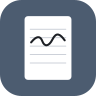
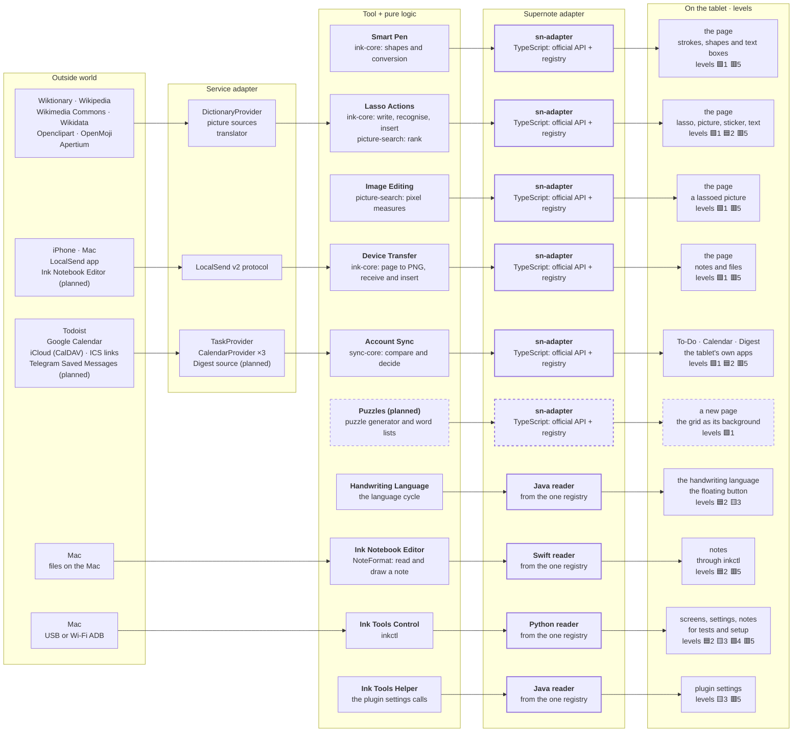

# Ink Tools

Unofficial tools for Supernote e-ink tablets: device plugins, a tablet app, a Mac control tool and a Mac notebook editor.

A monorepo of independent subprojects. Each keeps its own `AGENTS.md`, versioning and releases;
plugins and the tablet apps use SemVer with a numbered beta. A home page with the privacy policy,
at inktools.martonpaulo.com, is planned ([#371](https://github.com/martonpaulo/ink-tools/issues/371)).

<!-- tools:start: written by scripts/readme_figures.py from docs/tools.json -->

## Tools

For people who use the tablet.

<table>
  <tr><th>Name</th><th>What it does</th></tr>
  <tr><td align="center"> 

🟡&nbsp;<b>Smart Pen</b> <a href="https://github.com/martonpaulo/ink-tools/releases?q=smart-pen&amp;expanded=true">plugin</a>  </td><td> <ul><li><b>Smart Shapes</b>: draw a triangle, circle, square, rectangle or arrow and hold the pen still at the end; it becomes a clean shape, and letters stay handwriting.</li><li><b>Real-Time Text</b>: while it is on, each handwritten word becomes typed text at its place, with no lasso; drawings stay handwriting.</li><li><b>Undo Conversion</b>: brings the last converted word back as handwriting.</li><li><b>Gestures</b>: a finger double or triple tap picks a pen, the eraser or the lasso, as you map it. (planned)</li></ul> </td></tr>
  <tr><td align="center"> 

🟡&nbsp;<b>Lasso Actions</b> <a href="https://github.com/martonpaulo/ink-tools/releases?q=lasso-actions&amp;expanded=true">plugin</a>  </td><td> <ul><li><b>Word Lookup</b>: lasso a handwritten word, then Insert Sticker (a clean illustration), Insert Image (a photo), Choose Image (pick from the results), Insert Definition, Insert Summary (three sentences from Wikipedia) or Translate, one button per language pair, such as «Translate ES→PT».</li><li><b>Convert to Text</b>: turn the whole lassoed handwriting into one text box.</li><li><b>Headings</b>: Heading 1 to Heading 4 turn a lassoed line into a heading of that level at the left margin, across the page.</li><li><b>Collection</b>: Add to Collection and Cut to Collection gather lasso selections; Paste Collection puts them together on another page.</li></ul> </td></tr>
  <tr><td align="center"> 

🔵&nbsp;<b>Image Editing</b> <a href="https://github.com/martonpaulo/ink-tools/releases?q=image-editing&amp;expanded=true">plugin</a>  </td><td> <ul><li><b>Enhance</b>: make a lassoed picture readable on e-ink with one tap; Lighter and Darker adjust it.</li><li><b>Crop</b>: draw a rectangle with the pen around the part to keep.</li><li><b>Erase</b>: draw over the part to erase with the pen.</li><li><b>Remove background</b>: keep the subject and drop what is behind it.</li><li><b>Make sticker</b>: turn the picture into a sticker.</li><li><b>Document</b>: straighten a photographed page as a document.</li></ul> </td></tr>
  <tr><td align="center"> 

🟡&nbsp;<b>Device Transfer</b> <a href="https://github.com/martonpaulo/ink-tools/releases?q=device-transfer&amp;expanded=true">plugin</a> <a href="https://github.com/martonpaulo/ink-tools/issues/369">being renamed Device Link</a>  </td><td> <ul><li><b>Send Page</b>: send the open page to an iPhone or a Mac over LocalSend.</li><li><b>Send Selection</b>: send a lasso selection, as typed text or as a picture; you choose on each send.</li><li><b>Receive</b>: receive text, a picture or a PDF into the open note.</li><li><b>Editor helper</b>: applies the Ink Notebook Editor&#x27;s edits from the Mac to the tablet&#x27;s notes. (planned)</li></ul> </td></tr>
  <tr><td align="center"> 

🔵&nbsp;<b>Account Sync</b> <a href="https://github.com/martonpaulo/ink-tools/releases?q=account-sync&amp;expanded=true">plugin</a>  </td><td> <ul><li><b>To-Do</b>: sync the tablet&#x27;s to-dos with Todoist.</li><li><b>Calendar</b>: sync Google, iCloud and ICS calendars with the tablet&#x27;s calendar.</li><li><b>Digest</b>: sync the Digest both ways with your Telegram «Saved Messages». (planned)</li></ul> </td></tr>
  <tr><td align="center"> ⚪&nbsp;<b>Puzzles</b> <a href="https://github.com/martonpaulo/ink-tools/issues/376">plugin</a>  </td><td> <ul><li><b>New game</b>: pick a game, a language and a difficulty; the game is a new page after the current one, its grid drawn as the page background, so erasing never removes it.</li><li><b>Show solution</b>: shows the answer over the plugin&#x27;s view, never on the page.</li><li><b>Check</b>: reads what you wrote and marks the wrong cells.</li></ul> </td></tr>
  <tr><td align="center"> 

🟡&nbsp;<b>Handwriting Language</b> <a href="apps/handwriting-language/">app</a>  </td><td> <ul><li><b>Switch Language</b>: switch the handwriting recognition language of the whole tablet with one tap.</li><li><b>Floating button</b>: a small button where you write, shown only while there is text or ink input.</li></ul> </td></tr>
  <tr><td align="center"> 

🔵&nbsp;<b>Ink Notebook Editor</b> <a href="apps/ink-notebook-editor/">Mac app</a>  </td><td> <ul><li><b>Open a note</b>: read a <code>.note</code> notebook on the Mac and page through it.</li><li><b>Open from Tablet</b>: copy a note from the tablet over the cable through <code>inkctl</code> and open the copy.</li><li><b>Edit</b>: edit a note on the Mac without breaking the format, and send the edits back through Device Transfer. (planned)</li></ul> </td></tr>
</table>

Status: 🟢&nbsp;Working&emsp;🟡&nbsp;Beta&emsp;🔵&nbsp;In progress&emsp;⚪&nbsp;Planned&emsp;🟣&nbsp;Internal

## Developer tools

<table>
  <tr><th>Name</th><th>What it does</th></tr>
  <tr><td align="center"> 🟢&nbsp;<b>Ink Tools Control</b> <a href="cli/inkctl/">CLI</a>  </td><td> <ul><li><b>Control</b>: <code>inkctl</code> controls the tablet over Wi-Fi ADB or USB with direct calls, JSON answers and stable exit codes, without root.</li><li><b>Plugins</b>: install, enable, permit and uninstall plugins with no screen.</li><li><b>Notes and ink</b>: open notes, write synthetic ink, lasso and read the screen for tests.</li><li><b>Firmware watch</b>: on connect, check every device dependency and report what a firmware update broke. (planned)</li></ul> </td></tr>
  <tr><td align="center"> 

🟣&nbsp;<b>Ink Tools Helper</b> <a href="https://github.com/martonpaulo/ink-tools/releases?q=inktools-bridge&amp;expanded=true">app</a>  </td><td> <ul><li><b>Plugin settings</b>: lets <code>inkctl</code> install, enable and permit plugins with no screen.</li><li><b>Firmware watch</b>: at boot after a firmware change, check every device dependency and report what broke. (planned)</li></ul> </td></tr>
  <tr><td align="center"> 

🟣&nbsp;<b>Ink Tools Probe</b> <a href="https://github.com/martonpaulo/ink-tools/releases?q=plugin-diagnostics&amp;expanded=true">plugin</a>  </td><td> <ul><li><b>Run Command</b>: the sidebar button <code>inkctl</code> presses to write ink and lasso with no pen.</li><li><b>Probes</b>: quick on-device experiments for our tests. Never shipped.</li></ul> </td></tr>
</table>

<!-- tools:end -->

## How it fits together

Each row is one tool: where its data comes from, the adapter it enters through, and where it lands
on the tablet. Outside services always enter through an adapter of ours, so replacing one is a new
adapter, not a change to the tool. On the tablet side, every tool goes through one Supernote
adapter per language, and all of them read the same registry of device dependencies.

<!-- tool-map:start: written by scripts/readme_figures.py from docs/tools.json and registry/items -->

| Tool | Source | Adapter | Levels |
| :--- | :--- | :--- | :--- |
| Smart Pen | nothing from outside | sn-adapter | 🟩 1 🟥 5 |
| Lasso Actions | Wiktionary · Wikipedia, Wikimedia Commons · Wikidata, Openclipart · OpenMoji, Apertium | DictionaryProvider, picture sources, translator; sn-adapter | 🟩 1 🟦 2 🟥 5 |
| Image Editing | nothing from outside | sn-adapter | 🟩 1 🟥 5 |
| Device Transfer | iPhone · Mac, LocalSend app, Ink Notebook Editor (planned) | LocalSend v2 protocol; sn-adapter | 🟩 1 🟥 5 |
| Account Sync | Todoist, Google Calendar, iCloud (CalDAV) · ICS links, Telegram Saved Messages (planned) | TaskProvider, CalendarProvider ×3, Digest source (planned); sn-adapter | 🟩 1 🟦 2 🟥 5 |
| Puzzles (planned) | nothing from outside | sn-adapter | 🟩 1 |
| Handwriting Language | nothing from outside | Java reader | 🟦 2 🟨 3 |
| Ink Notebook Editor | Mac, files on the Mac | Swift reader | 🟦 2 🟥 5 |
| Ink Tools Control | Mac, USB or Wi-Fi ADB | Python reader | 🟦 2 🟨 3 🟪 4 🟥 5 |
| Ink Tools Helper | nothing from outside | Java reader | 🟨 3 🟥 5 |

<!-- tool-map:end -->

The levels in the last column are dependency levels. Each level is as fragile as the part of the
tablet it depends on, and each part a tool depends on below level 1 has a written reason and a check that
runs after a firmware update, so it never breaks silently.

<!-- levels:start: written by scripts/readme_figures.py from docs/architecture.md and registry/items -->

Use the highest level that delivers the outcome at acceptable cost and quality.

| Level | Examples | When it breaks | Where it is tested | Registry items |
| :--- | :--- | :--- | :--- | ---: |
| 🟩 1 · Official plugin API | lasso, insert a picture, pages, files, buttons, dialogs | rarely, with Ratta's notice; affects the person | Mac tests, with the simulated adapter | none needed |
| 🟦 2 · Device data | Calendar, To-Do and Digest entries; the handwriting language; the note file format | any firmware update; the probe sees it; affects the person | a tablet probe of fields, paths and versions | 11 |
| 🟨 3 · System screens and components | native switches and bars, the helper app, Settings shortcuts | any firmware update; a call fails; affects the person | a tablet probe that loads and checks each one | 7 |
| 🟪 4 · Screen automation | find buttons by their text in Settings and in notes | any interface change; a step fails; affects only our tests | `inkctl doctor` before each test round | 3 |
| 🟥 5 · Observed device behaviour | the Back key, pen units, how Calendar and To-Do read entries | **silently**; affects the person | an effect test: write, read back, compare | 24 |

Level 1 is the highest and the steadiest; level 5 is the lowest and changes with no error.

<!-- levels:end -->

The tool tables, the tool map and the level table are generated by `scripts/readme_figures.py` from
[`docs/tools.json`](docs/tools.json), the level table of [`docs/architecture.md`](docs/architecture.md#layer-rules)
and the [registry](registry/); a check fails when they fall behind.

**This is unofficial.** Not affiliated with, endorsed or reviewed by Ratta. The plugins ship here as
unofficial GitHub releases: install them at your own risk. "Supernote" is a trademark of its
owner, used here only to name the device. No root, no modified firmware, no exploits.

## License

[CC BY-NC-SA 4.0](LICENSE) © 2026 Marton Paulo. Each subproject preserves its own `NOTICE.md` and third-party
notices.
