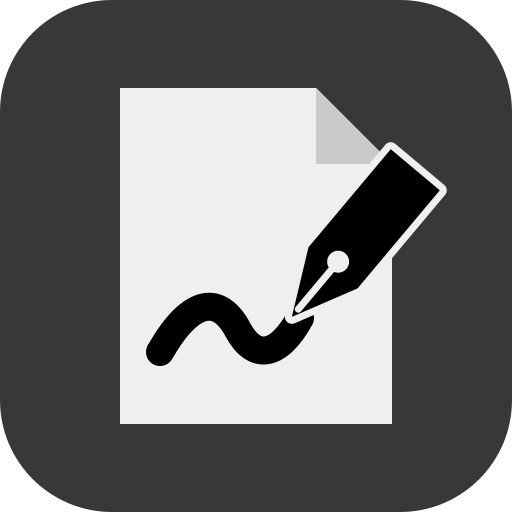

# Ink Tools

Unofficial tools for Supernote e-ink tablets: device plugins, a tablet app, a Mac CLI and a planned Mac notebook editor.

A monorepo of independent subprojects. Each keeps its own `AGENTS.md`, versioning and releases;
plugins and the tablet apps use SemVer with a numbered beta.

## Plugins

Run inside the tablet's plugin host.

| Plugin | What it does | Folder | Status |
| :--- | :--- | :--- | :--- |
| **Word Lookup** | Write a word by hand, lasso it, and insert an illustration, a photo, a short definition or a translation; «Choose Image» opens the results to pick one. | [`word-lookup/`](plugins/word-lookup/) | 🟡&nbsp;Beta |
| **Real-Time Conversion** | While «Real-Time Text» is on, each handwritten word becomes typed text at its place, with no lasso; drawings stay handwriting, and «Undo Conversion» brings the last word back. | [`real-time-conversion/`](plugins/real-time-conversion/) | 🟡&nbsp;Beta |
| **Smart Shapes** | Draw a triangle, circle, square, rectangle or arrow and hold the pen still at the end: it becomes a clean shape; letters stay handwriting. | [`smart-shapes/`](plugins/smart-shapes/) | 🟡&nbsp;Beta |
| **Device Transfer** | Send the page or a lasso selection to an iPhone or a Mac over LocalSend, and receive text or a picture into the open note. | [`device-transfer/`](plugins/device-transfer/) | 🟡&nbsp;Beta |
| **Account Sync** | Sync to-dos, calendars and a digest with your accounts, each module opt in. | [`account-sync/`](plugins/account-sync/) | 🔵&nbsp;In&nbsp;progress |
| **Image Editing** | Lasso a picture on the page and make it readable on e-ink with one tap. | [`image-editing/`](plugins/image-editing/) | 🔵&nbsp;In&nbsp;progress |
| Plugin Diagnostics | Quick on-device experiments for developers. Never shipped. | [`plugin-diagnostics/`](plugins/plugin-diagnostics/) | ⚫&nbsp;Internal |

## Tablet apps

Sideloaded Android apps.

| App | What it does | Folder | Status |
| :--- | :--- | :--- | :--- |
| **Handwriting Language** | Switch the handwriting recognition language of the whole tablet with one tap. | [`handwriting-language/`](apps/handwriting-language/) | 🟡&nbsp;Beta |
| Ink Tools Bridge | Lets `inkctl` install, enable and permit plugins with no screen, through PluginHost's settings service. Developer-only. | [`inktools-bridge/`](apps/inktools-bridge/) | ⚫&nbsp;Internal |

## Mac CLI

| Tool | What it does | Folder | Status |
| :--- | :--- | :--- | :--- |
| **inkctl** | Control the tablet over Wi-Fi ADB with direct calls, JSON answers and stable exit codes, without root. | [`inkctl/`](cli/inkctl/) | 🟢&nbsp;Working |

## Mac app

| App | What it does | Folder | Status |
| :--- | :--- | :--- | :--- |
| **Ink Notebook Editor** | Read and edit `.note` notebooks on the Mac without breaking the format. | [`ink-notebook-editor/`](apps/ink-notebook-editor/) | ⚪&nbsp;Planned |

## Shared code

| Package | What it does | Folder | Status |
| :--- | :--- | :--- | :--- |
| Shared code | `sn-adapter`, `sync-core`, `ink-core`, `picture-search` and `ui-kit`, bundled by the plugins. | [`packages/`](packages/) | ⚫&nbsp;Internal |

**This is unofficial.** Not affiliated with or endorsed by Ratta. "Supernote" is a trademark of its
owner, used here only to name the device. No root, no modified firmware, no exploits.

## License

[CC BY-NC-SA 4.0](LICENSE) © 2026 Marton Paulo. Each subproject preserves its own `NOTICE.md` and third-party
notices.
